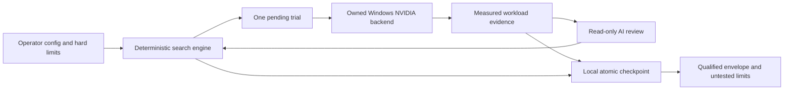

# GPU LimitSeeker

**A short pass is not a stability certificate.**

AI-reviewed GPU limit exploration: start from your **current** profile, refine the failure bracket, long-test the higher candidates, and keep evidence separate from guesses.

[中文说明](README.zh-CN.md) · [MIT](LICENSE) · [Upstream licenses and pinned hashes](THIRD_PARTY_NOTICES.md)

> **Alpha. Overclocking can crash the driver or OS, corrupt data, and damage hardware.** This is not a guarantee of all-games stability, an exact physical maximum, safe PSU transients, or improved performance. The generalized aggressive policy and power sweep have **offline validation only**, not a new live-hardware qualification campaign. Start supervised. Do not leave an unqualified setup unattended.

## What it does

- Exact-current baseline: no zero-offset first benchmark or silent power reset.
- Separate core, memory and measured-reference V/F search, then matched fan comparisons and final combined qualification.
- Coarse screening → resolution-level bracket refinement → **highest screened candidate first** in LONG tests. A long failure retires that exact profile and tests the adjacent lower point; it does not automatically jump to a comfortable preset.
- Independent approved power points. A 100% pass does not validate 110% or 125%. Driver caps, AI stops and budget limits are not labelled physical limits.
- A real AI review at each decision boundary, inside an immutable deterministic envelope. The AI returns a small JSON decision, never shell commands or hardware writes.
- Owned workloads, thermal stop, bounded TDR recovery, crash-released writer lock, cumulative runtime, local evidence and explicit checkpoint resume.
- Default completion restores original settings while ownership is confirmed. If another clock controller appears, relinquish rather than overwrite the user's settings. Saved recommendations are **not** automatically installed as Afterburner startup profiles.

## Try it without touching a GPU

Python 3.11+; the synthetic demo is portable and uses only the standard library.

```powershell
git clone https://github.com/JialongMei/GPU-LimitSeeker.git
cd GPU-LimitSeeker
python -m pip install .
gpu-limitseeker --help
gpu-limitseeker demo --powers 100,110,125
```

The demo clearly marks invented clocks, watts, scores and accelerated durations. It uses a **scripted fixture, not a real AI model**, and does not query a GPU, download tools or contact a provider. There is no implicit fake backend in live mode.

## Live setup — Windows/NVIDIA only

Single NVIDIA GPU initially. Requires supported driver telemetry, current V/F readback, native fan control, compatible GAO/MACM interfaces, Vulkan and the pinned external tools. Unsupported/ambiguous devices fail closed. Negative initial offsets are not supported. A custom initial curve requires an explicit matching standalone `hardware.baseline_profile`; do not mislabel it as a uniform offset.

Supported standalone flat-top originals additionally require a post-baseline, same-vector native setter proof before any destructive reset. The captured raw vector is restored exactly and independently read back; CLI flatten is not treated as an exact inverse. Arbitrary non-flat upper shapes are refused without a write. The pinned-ABI bridge is also live-unqualified in this alpha.

1. Save work and back up your existing Afterburner profiles. Use a supervised session with adequate PSU/cooling/cabling. A driver's maximum slider is **not** a PSU safety certificate.
2. Install the package; obtain the exact tools manually, or explicitly download them:

   ```powershell
   gpu-limitseeker tools fetch --accept-downloads
   gpu-limitseeker init-config config.json
   ```

   Downloads are hash-checked and **not executed** by this command. No proprietary driver/MSI binaries are distributed. No antivirus, SmartScreen, UAC, TDR registry or execution-policy bypass is implemented.
3. Edit `config.json`, or start with [`examples/config.toml`](examples/config.toml). Specify AI credentials/provider, expected original power and any custom baseline. `hardware.allow_afterburner_handoff` defaults false: only explicitly enable it if closing Afterburner/RTSS and handing clock control to this process is acceptable. Your first baseline still precedes that handoff.
4. Optional explicit read-only inspection:

   ```powershell
   gpu-limitseeker inspect --config config.json
   ```

   This reads local GPU state; it does not pressure-test or write settings. The output may contain device identifiers: keep it private.
5. In a terminal **you opened as Administrator**, explicitly accept the risk:

   ```powershell
   gpu-limitseeker run --config config.json --i-accept-gpu-risk
   ```

   The program does not elevate itself or answer UAC. Leave NVIDIA automatic tuning and other competing clock writers off.

### Real AI, not a live fallback

For an OpenAI-compatible Chat Completions endpoint:

```toml
[ai]
provider = "openai"
model = "YOUR_PROVIDER_MODEL_ID"
base_url = "https://api.openai.com/v1"
api_key_env = "GPU_LIMITSEEKER_API_KEY"
timeout_seconds = 120
max_attempts = 2
```

Set the named environment variable locally; never put a key in a config or Git commit. A valid fresh preflight response is required **before the native backend is constructed**. A malformed/stale/refused/timeout response stops rather than choosing a made-up live decision. Providers may charge for calls.

Alternatively use `provider = "omp"`, an explicit model ID and optionally `command` pointing to a compatible **native** OMP executable. OMP uses its own credentials. The adapter requires print/no-tools/no-session/no-extensions/no-skills/no-rules/no-context-files/no-LSP/no-title isolation, an explicit reviewer system prompt and a neutral root cwd; wrapper batch scripts and incompatible CLIs are refused. It passes JSON directly, not a private `@file` attachment. It does not resume this assistant's conversation, load project agents, or grant approval-bypass flags.

The adapter sends only allowlisted bounded experiment metrics. UUIDs, machine paths, raw tool logs, API keys and free-form result details are excluded. Full local evidence is **not** uploaded. OMP may add its own generic runtime/provider metadata; use the HTTP adapter when you need direct control of the request envelope. Your selected provider still receives sanitized metrics; inspect its privacy/cost policy.

## Power is an independent search axis

Percent means **board power-limit percentage relative to that GPU's default TDP**, not watts or voltage. Raising the power limit permits more power; it does not command maximum voltage or guarantee higher sustained clocks. Voltage boost remains unchanged; curve anchors are not fixed-voltage/frequency locks.

Defaults are deliberately single-point:

```toml
[safety]
power_percent = 100         # Expected ORIGINAL state; first baseline does not write it
max_power_percent = 100

[search]
power_limits = [100]
```

An opt-in sweep must explicitly set both ceilings and the points, for example **only for a hypothetical default-300W card and a system whose owner approved 375W board power**:

```toml
[safety]
power_percent = 100
max_power_percent = 125
max_hours = 48              # Explicit multi-day example, not the default
max_board_power_w = 375

[search]
power_limits = [100, 110, 125]
```

It additionally requires `--allow-above-default-power` at live launch. Actual driver min/max limits and independent readback must agree. Live power adjustment requires driver-supported `nvidia-smi` power writes; a reported range alone does not guarantee write support. A refusal never becomes a fake successful point. This example is **not** a PSU recommendation or permission to use 125% on another machine.

GAO resets temporarily return the cap to 100% while idle. If 100% or default board watts are outside your explicit envelope, clock-write admission refuses **before handoff or a reset**, rather than silently exceeding a lower-power authorization.

Each power point restarts from the original clock configuration, rechecks it at the new power and repeats search/long qualification. Reports retain per-point results, actual achieved clocks, actual sampled watts, best measured performance and measured score/watt. The configured cap is never substituted for measured power. Unreached points remain untested.

## Duration, stopping and recovery

Default LONG qualification is **3600s full + 600s half + 3600s VRAM** for one candidate, not one short loop. That is 130 minutes before overhead. The default single-power budget is 24 hours; explicitly configured multi-day campaigns may use up to 72 hours, with the same GLOBAL temperature, watt and recovery limits. A common core + memory + three-anchor + final path already needs six LONG qualifications, about 13 hours per power point before screening/overhead; three power points can therefore require multiple days. Set a deliberate larger budget (for example 48 hours), fewer anchors, or explicitly chosen shorter qualification durations; changing durations changes the strength of the evidence. A finite budget can expire before every point qualifies. Tests are never shortened automatically and unreached points remain untested.

For a separate native console/process, add `--background`. This creates no scheduled task, login persistence or reboot loop. Terminal independence does not imply immunity to OS crashes, sleep, driver faults or process termination. During live work a bounded system-awake lease allows the display to turn off; it does not edit the power plan or prevent user-requested sleep. A real AI call decides each completed round, independent of this chat window.

Runtime defaults to `%LOCALAPPDATA%/GPU-LimitSeeker/runs/...`, outside the repository. Keep all runtime/config/consent/log files private.

```powershell
gpu-limitseeker status --run-dir PATH_TO_RUN
gpu-limitseeker stop --run-dir PATH_TO_RUN
```

STOP requests bounded owned-child shutdown and ownership-aware restoration; it is not proof of instantaneous cancellation of an uninterruptible native call. Do not start another writer when cleanup is unconfirmed.

Known between-round checkpoints can be resumed explicitly after removing STOP and restoring the original profile:

```powershell
gpu-limitseeker resume --run-dir PATH_TO_RUN --i-accept-gpu-risk
```

Resume preserves original time/recovery budgets, verifies device/driver/original profile and performs a fresh original-profile baseline. Completed evidence awaiting AI review is consumed without replaying its pressure. **Unknown interrupted pressure or native recovery is never automatically replayed.** Inspect local evidence and recover manually; do not turn a crash loop into an unattended retry loop.

## Architecture



`engine.py`, `models.py` and the synthetic fixture are hardware-free. `hardware/` owns all native writers and child processes. `controller.py` owns lifecycle and cumulative budgets. `ai.py` owns strict provider parsing/privacy. `tools.py` owns explicit pinned downloads. Missing telemetry, uncertain writes, thermal latch and ownership changes are safety outcomes, not overclock failures to hide.

## Development and evidence

```powershell
python -m pip install .
python -m unittest discover -s tests -v
python -m gpu_limitseeker demo --powers 100,110,125
```

Tests use synthetic records, injected transports and mocked native boundaries. The [GPU-free CI template](examples/github-actions-offline.yml) is provided as an example, **not an active GitHub Actions workflow**. Repository owners can explicitly enable it; this project does not request or expand account permissions. The template never launches a stress tool, touches a GPU or uses AI credentials. Offline correctness cannot establish live clock stability, PSU safety or every supported-driver interaction. Live results must be qualified on the actual system, then checked in the user's real workloads/games.

## License

MIT. See [THIRD_PARTY_NOTICES.md](THIRD_PARTY_NOTICES.md) for external tool licenses and hashes. No warranty; no affiliation with NVIDIA or MSI.
